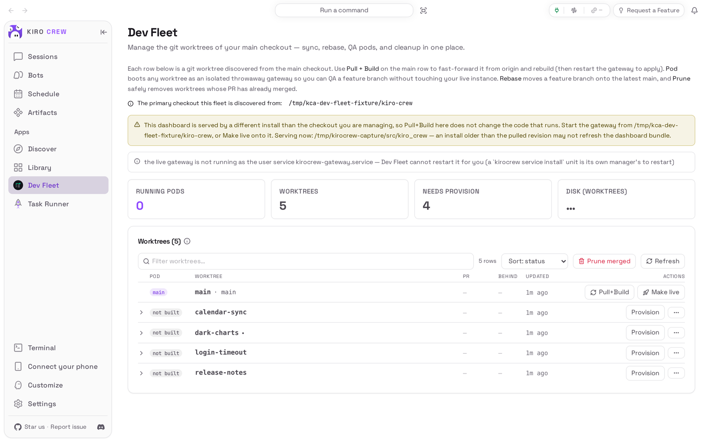
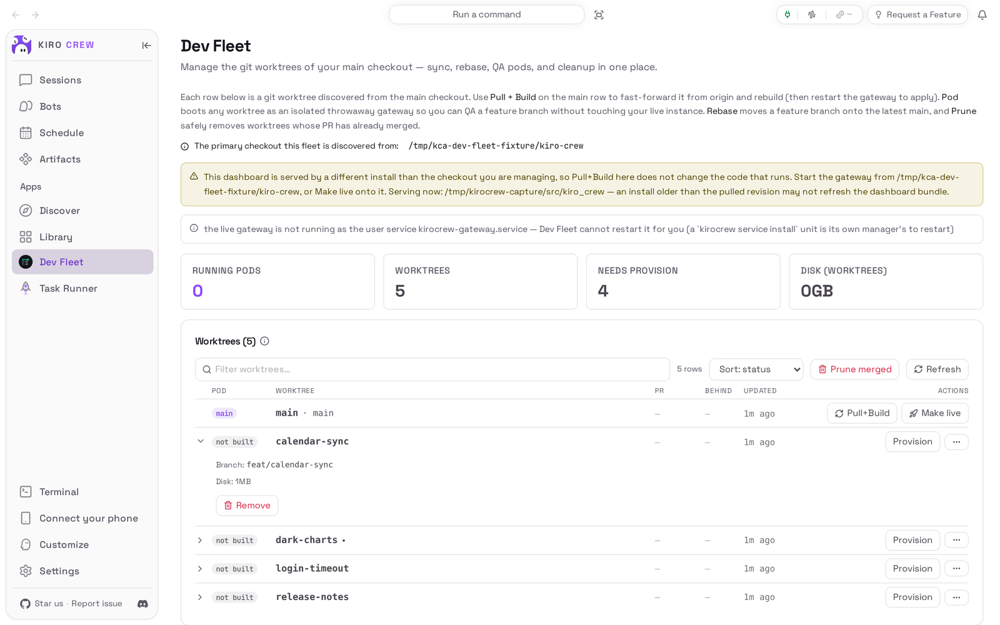
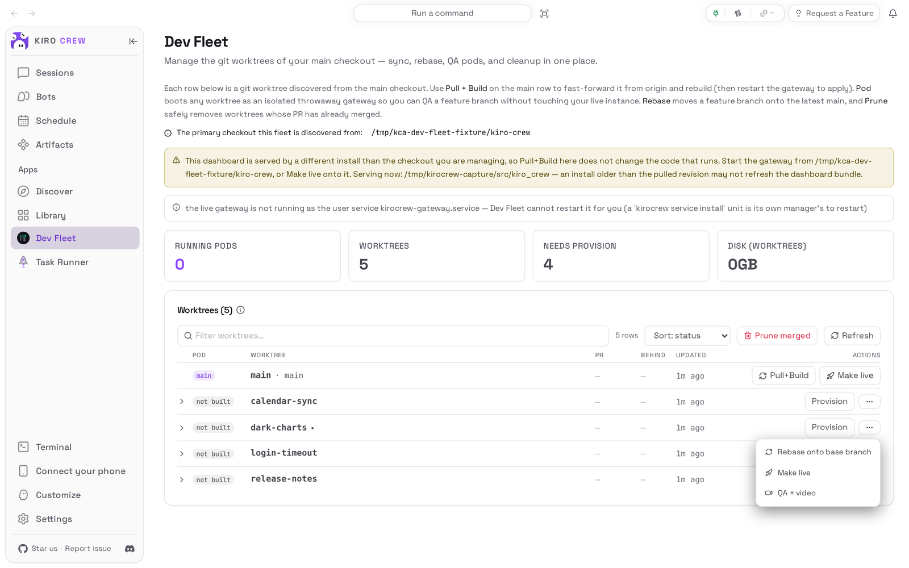
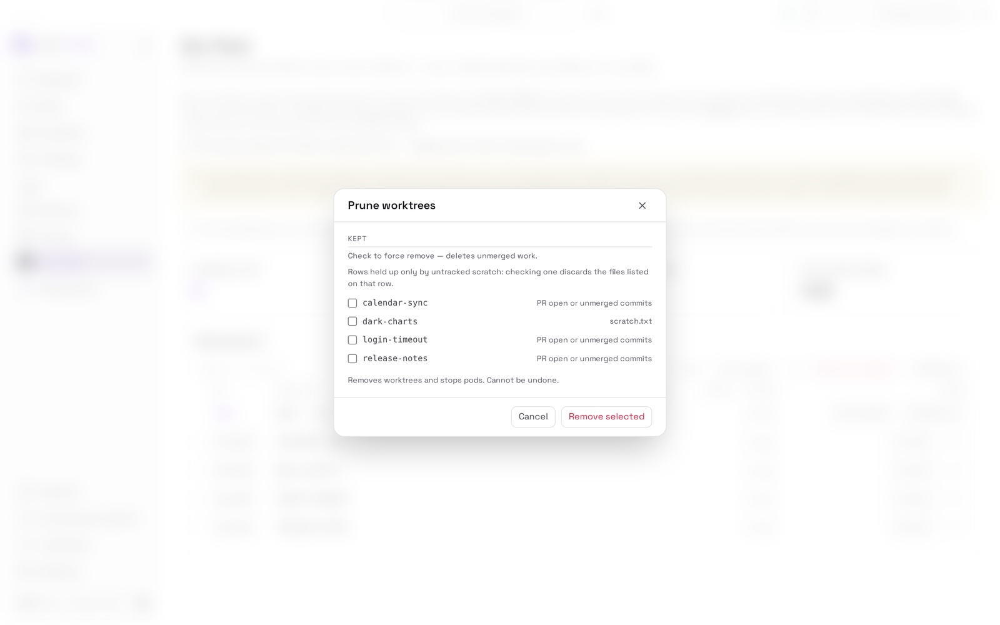
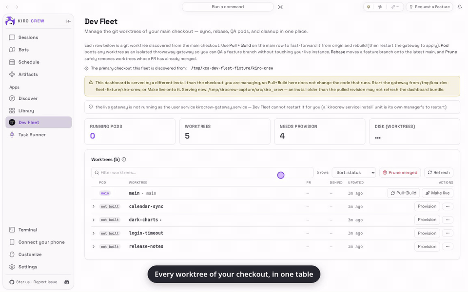

# Dev Fleet

<picture>
  <source media="(prefers-color-scheme: dark)" srcset="docs/media/hero-dark.png">
  
</picture>

**A control panel for people who work on Kiro Crew itself: every feature worktree of your checkout in one table, and any of them brought up as a preview.**

Dev Fleet is an app for [Kiro Crew](https://github.com/kirodotdev/KiroCrew),
the open-source personal AI agent. You only need it if you change Kiro Crew's own
code.

## What it is

Dev Fleet adds a **Dev Fleet** page to Kiro Crew. It lists every git worktree of
your Kiro Crew source checkout with its branch, how far it is behind, when it last
changed and its pull-request state, and it can bring any of them up as a **pod**:
a complete preview copy of Kiro Crew on its own port with its own data folder, so
you can click through an unfinished change without touching the Kiro Crew you use
every day. It also pulls and rebuilds your main checkout, rebases a branch, shows
pod logs and removes worktrees whose work has shipped. Turning it on also lets
agents start and stop pods, which means code from a worktree an agent can write
runs outside the agent's sandbox, as you.

**Get started:** Dev Fleet comes with Kiro Crew, switched off. Open
**Apps → Library**, choose **Show N disabled apps**, then on the **Dev Fleet** tile
open the **⋯** menu and choose **Enable**. [Install](#install) has the details.

## The problem it solves

When you work on several Kiro Crew changes at once, each lives in its own git
worktree, and keeping track of them means a terminal per branch: which ones are
behind, which have a pull request, which are already merged and can go, and how to
try one out without stopping the Kiro Crew you are using.

Dev Fleet puts that list in the dashboard, and turns "try this branch" into one
button that starts a separate, throwaway copy of Kiro Crew for it.

## Top 3 use cases

### 1. See where every branch stands

You come back after a few days and want to know what is in flight. The table lists
the main checkout and each feature worktree: whether it has been built, its pull
request, how many commits it is behind main, and when it last changed. A dot after
a name means it has uncommitted changes. Choose the arrow at the start of a row to
see its branch, its disk use and a **Remove** button.



### 2. Act on one worktree

A feature is ready to try. Choose **Provision** once to build the worktree, then
start its pod and open it. The **⋯** menu on each row has the rest: **Rebase onto
base branch**, **Make live** (switch your everyday Kiro Crew to this checkout) and
**QA + video**, which asks the agent to test the pod and record a short demo.



### 3. Clean up what has shipped

Worktrees pile up. **Prune merged** checks each one and shows a review before
anything is deleted: a worktree is offered for removal only when its pull request
is merged and nothing in it is uncommitted. Everything else is kept with the
reason, and you can tick a kept row to force it.



## Watch it



[Watch the walkthrough as a video (MP4)](docs/media/walkthrough.mp4).

<sub>Recorded from a real, isolated Kiro Crew dashboard (Kiro Crew `6d07df11cf`)
serving this repository's own copy of the app, on a made-up checkout with four
invented branches and no GitHub remote, so no pull request appears and Prune keeps
every worktree. No pod was provisioned and no AI model was used. The recording
starts after a 50-second settle described in [PORTING.md](PORTING.md) (gap 10).</sub>

## Install

**Today: Dev Fleet comes with Kiro Crew.** Nothing needs downloading. It starts
switched off:

1. In Kiro Crew, open **Apps → Library** in the left sidebar.
2. Choose **Show N disabled apps** (N is how many apps are switched off).
3. On the **Dev Fleet** tile, open the **⋯** menu and choose **Enable**.
4. **Dev Fleet** now appears under **Apps** in the sidebar.

**Later: from this repository.** This repository is the app's own home. Kiro Crew
does not move existing users onto it yet, and while Kiro Crew ships its own Dev
Fleet a second copy with the same name cannot be installed beside it.
[PORTING.md](PORTING.md) lists what is still missing.

What you need: Kiro Crew on a Mac, Linux or Windows computer, a Kiro Crew source
checkout made with git, and **git**. Pull-request state needs the GitHub CLI
(**gh**) signed in. Pods need systemd user services on Linux, launchd on macOS or
Task Scheduler on Windows; on a Mac a pod has no enforced memory or CPU limit.

## First run

Open **Dev Fleet** from the sidebar. It looks for your Kiro Crew checkout and
lists its worktrees. If it found the checkout by itself, a line above the table
names the folder it uses. If it finds none, the page says **No Kiro Crew checkout
found** and tells you how to name one (see [Settings & data](#settings--data)).

## How to use it

1. **Refresh.** The table refreshes itself every 12 seconds; **Refresh** reads
   everything again now. Type in **Filter worktrees** to narrow the list, and use
   the **Sort** box to order it by status, recent changes, name or how far behind.
2. **Update main.** On the main row, choose **Pull+Build**: it pulls the latest
   main and rebuilds. Restart Kiro Crew afterwards to use the new build.
3. **Try a branch.** On a feature row, choose **Provision** (once; it installs what
   the branch needs, which can take a few minutes), then start the pod. When it is
   up, open it from the row: it is a separate Kiro Crew with its own data.
   Stop it when you are done; stopping deletes the pod's data folder.
4. **Rebase.** **⋯ → Rebase onto base branch** moves the branch onto the latest
   main. If git finds a conflict, the rebase is undone and the row says so.
5. **Make live.** **⋯ → Make live** switches your everyday Kiro Crew to run from
   that checkout after a restart, and a banner offers **Switch back**.
6. **Clean up.** Choose **Prune merged**, read the review, tick what to remove and
   choose **Remove selected**, or **Cancel** to remove nothing.

Limits of this repository's copy today: **Make live**, **Restart gateway** and
opening a pod are refused by Kiro Crew's permission check, because those three
reach Kiro Crew's own routes outside what the app is allowed to call
([PORTING.md](PORTING.md), gap 3). The copy that comes with Kiro Crew does them.

## Settings & data

- **Which checkout.** Dev Fleet uses, in order: the `KIROCREW_DEVFLEET_REPO`
  environment variable, `dev_fleet.repo_path` in Kiro Crew's `config.json` (in
  your Kiro Crew data folder, `~/.kiro/crew` by default; picked up on the next
  refresh), the folder Kiro Crew runs from, then a folder named `kirocrew` or
  `kiro-crew` in the usual places under your home folder.
- **What it stores.** Its own log under the app's data folder in Kiro Crew
  (`apps/dev-fleet/data/`). Pods keep their data and settings under your home
  folder (`~/.kirocrew-pods`) and Kiro Crew's data folder (`pods/`). **Make live**
  writes one small pointer file in Kiro Crew's data folder, and nothing else about
  your service.
- **What leaves the computer.** git talks to your checkout's remote when it
  pulls, rebases or checks what is merged, and **gh** asks GitHub for pull-request
  state. Nothing else is sent anywhere by the app.
- **Off and removed.** Turning the app off removes its page; it deletes no
  worktree. Removing a worktree from the page deletes that folder for good.

## Troubleshooting

- **"No Kiro Crew checkout found".** Add `dev_fleet.repo_path` to `config.json`
  as the page shows; it is picked up on the next refresh.
- **"Discovery Error" naming a folder.** That folder is not a Kiro Crew checkout,
  or a config file could not be read. Fix the path or the file it names.
- **A note says this dashboard is served by a different install.** **Pull+Build**
  updates the checkout, not the Kiro Crew you are looking at. Start Kiro Crew from
  that checkout, or **Make live** onto it.
- **"Live state unavailable" right after turning the app on.** It clears on its
  own within about a minute.
- **No pull-request column filled in.** Install the GitHub CLI and sign in.
- **Prune keeps everything.** It removes only worktrees it can prove shipped: with
  no merged pull request, or with uncommitted files, a worktree is kept and the
  review says why.

## Development

The app has three parts: `backend/`, an aiohttp server Kiro Crew starts in its
sandbox (`backend/launch.py`) and reaches through its signed proxy; two families of
routes Kiro Crew runs inside its own process (`backend/gateway_hooks.py`, the pod
routes agents call and the live-checkout switch); and `ui/`, the page, built into
the committed bundle `ui/dist/index.mjs`. The two bundled skills are in `skills/`.
[PORTING.md](PORTING.md) explains how it was moved out of Kiro Crew and what is
still missing.

### Tests

```bash
python -m pip install -r tests/requirements.txt
# A Kiro Crew source checkout at the pinned commit, installed editable:
git clone https://github.com/kirodotdev/KiroCrew ../KiroCrew
git -C ../KiroCrew checkout "$(cat tests/kirocrew-commit.txt)"
python -m pip install -e ../KiroCrew
python -m pytest -n 4 --dist loadgroup
python -m flake8 backend tests skills capture

cd ui
npm ci
npm run typecheck
npm test
npm run build   # rewrites ui/dist/index.mjs; CI fails if it differs from the commit
```

The Python suite is Kiro Crew's own Dev Fleet suite, and like there it runs
against a Kiro Crew source checkout (several tests discover the checkout the
running code comes from). It never starts, stops or
reconfigures a real service and runs without your systemd user session
(`tests/host_service_floor.py`).

### Re-capture the README media

The pictures and the recording come from a real, isolated Kiro Crew gateway driven
by [`capture/`](capture/README.md), on a fictional checkout that
`capture/make_fixture.py` builds under the system temp directory:

```bash
python capture/make_fixture.py
HOME=$(mktemp -d) KIROCREW_PROJECT_DIR=/tmp/kca-dev-fleet-fixture/kiro-crew \
  python capture/capture.py --kirocrew /path/to/KiroCrew
python capture/check_readme.py
```

While Kiro Crew ships its own Dev Fleet, the checkout passed to `--kirocrew` must
have the built-in copy removed so this repository's copy can be installed
(`docs/media/media.json` records it). Then look at every image and at a few frames
of the video before committing (see [CHECKLIST.md](CHECKLIST.md)).

## License

Apache License 2.0. See [LICENSE](LICENSE) and [NOTICE](NOTICE).
